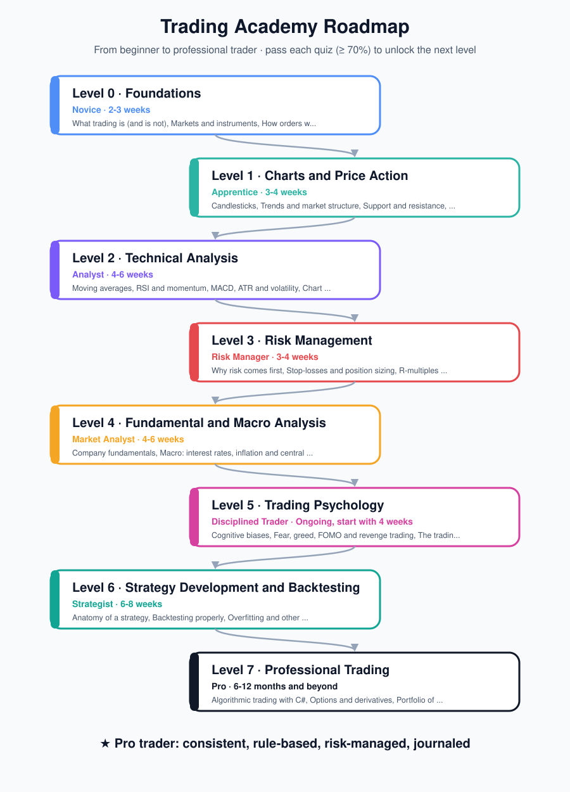
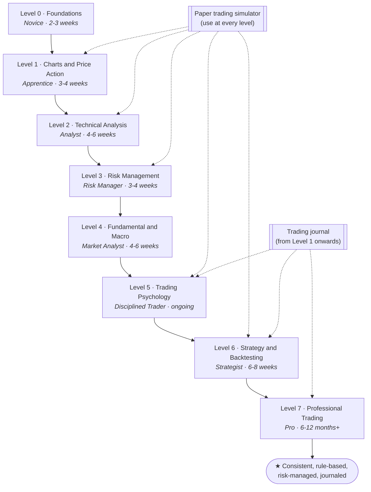

# The Roadmap: from beginner to professional trader

This roadmap has **8 levels**. Each level has lessons (in the app and in [`docs/levels`](levels)), practice tasks, milestones and a quiz. You unlock the next level in the app by scoring **70% or more** on the quiz. Expect the whole path to take **12-24 months** of steady part-time study and practice. That is normal: trading is a skill, like learning an instrument.

## The three phases

| Phase | Levels | You can... | Money at risk |
|---|---|---|---|
| **1. Learn the language** | 0-2 | read charts, place orders, use indicators | None: demo and simulator only |
| **2. Learn to survive** | 3-5 | size positions, read the macro picture, control emotions, follow a written plan | None, or a very small 'tuition' account |
| **3. Build an edge** | 6-7 | design, test and automate strategies, manage a portfolio, run trading as a business | Small live size, scaled only on evidence |

## Level overview

| Level | Topics | Study guide | Done when |
|---|---|---|---|
| 0 Foundations | Trading vs investing, instruments, orders, brokers and costs | [level-0.md](levels/level-0.md) | Demo account open, orders understood, quiz passed |
| 1 Charts and Price Action | Candlesticks, trend structure, support/resistance, timeframes, volume | [level-1.md](levels/level-1.md) | You can describe any chart in words |
| 2 Technical Analysis | Moving averages, RSI, MACD, ATR, Bollinger Bands, chart patterns | [level-2.md](levels/level-2.md) | One written setup with max two indicators |
| 3 Risk Management | Drawdown maths, stops, position sizing, R-multiples, expectancy, Kelly | [level-3.md](levels/level-3.md) | 5 simulator sessions in a row with drawdown < 10% |
| 4 Fundamental and Macro | Earnings, P/E, central banks, inflation, calendar, sentiment, oil and NOK | [level-4.md](levels/level-4.md) | You check the calendar and earnings dates by habit |
| 5 Trading Psychology | Biases, fear/greed/FOMO, revenge trading, the trading plan, journaling | [level-5.md](levels/level-5.md) | Written plan followed for 20 trades, weekly reviews |
| 6 Strategy and Backtesting | Strategy anatomy, honest backtests, overfitting, forward testing | [level-6.md](levels/level-6.md) | 100+ trade backtest and matching paper results |
| 7 Professional | C# algorithmic trading (QuantConnect LEAN), options and greeks, portfolios, execution, business | [level-7.md](levels/level-7.md) | 6+ months of journaled, plan-following results |

## A weekly routine that works at every level

| Day | Time | Activity |
|---|---|---|
| Mon-Thu | 30-45 min | One lesson or reading chapter + one practice task |
| Mon-Thu | 15 min | One simulator session (`Paper trading` in the app) |
| Fri | 30 min | Quiz yourself, update the journal |
| Weekend | 45 min | Weekly review using [the template](templates/WEEKLY-REVIEW.md), plan next week |

## Rules that apply from day one

1. **No real money before Level 3 is passed.** Use the simulator and a broker demo account.
2. **Risk 1% or less per trade**, always with a stop-loss decided before entry.
3. **Journal every trade**, including the emotion you felt.
4. **No leverage** until Level 6, and then only with strict position sizing.
5. **If you lose 10% of your trading account, stop** and go back to the simulator for two weeks.

## Pro checklist

You are trading like a professional when you can tick every box:

- [ ] I have a written trading plan and I follow it.
- [ ] Every strategy I trade has been backtested (100+ trades, with costs) and forward tested.
- [ ] I know the expectancy, win rate, average R and worst drawdown of each strategy.
- [ ] I never risk more than my planned amount per trade, day and week.
- [ ] I have a journal with at least 6 months of trades and a weekly review habit.
- [ ] I know when I will stop trading a strategy (pre-defined drawdown limit).
- [ ] I trade multiple uncorrelated strategies or markets within a total risk budget.
- [ ] I can automate at least one strategy in code, with kill switches.
- [ ] I keep tax records and know the regulations that apply to me.

See [SOURCES.md](SOURCES.md) for the full reading list.
